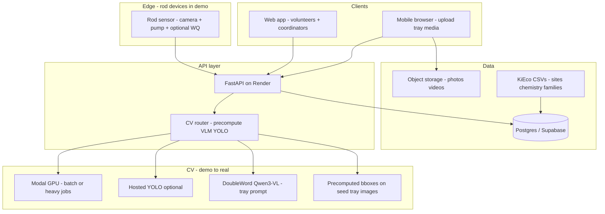
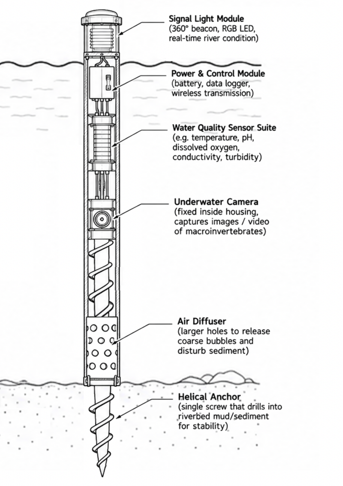

# River macroinvertebrate platform — technical plan (hackathon)

## 1. Product summary

**Goal:** Monitor river health via macroinvertebrate assemblages — faster and more scalable than volunteer-only 3-minute kick sampling, while still supporting that workflow.

**Two inputs, one platform:**


| Source                                         | What it provides                                                           |
| ---------------------------------------------- | -------------------------------------------------------------------------- |
| **Volunteer phone**                            | Tray photo/video after kick sample → CV classifies families                |
| **Bed-mounted rod sensor** (teammate hardware) | Timelapse + optional agitation + optional WQ probes → automated detections |


**Core insight from NRW KiEco data:** The joined CSV already **spatially links** each macroinvertebrate survey to the nearest routine water-chemistry monitoring station. Column `nearest_station_m` has a **median of 44 m** (73% of site-visits within 100 m) — i.e. bug samples and chemistry probes are effectively the **same reach**, not random unrelated points. That is why we can show “bugs + BOD/DO” on one sidebar without building a new join in the hackathon. The app should treat **site × date** as the atomic unit, not raw 648k GBIF rows.

---

## 2. Architecture (hackathon-shaped)



### Recommended stack (optimize for speed of build)

**Deployment (your accounts — no Vercel):**

| Layer | Choice | Host | Notes |
| ----- | ------ | ---- | ----- |
| Frontend | Vite + React + TypeScript | **Netlify** | Static build + env vars; you already use Netlify |
| Map | MapLibre GL + OSM tiles | (bundled in FE) | — |
| Backend API | **FastAPI** (sites, uploads metadata, dex, inference *router*) | **Render** web service | Long-lived Python; straightforward deploy |
| DB | Postgres | **Render** managed Postgres *or* Supabase free tier if you only want DB/Storage from them | ETL loads KiEco; optional Supabase Storage for images |
| Object storage | Tray images | Render disk (demo) / Supabase Storage / Netlify Large Media | Keep URLs in Postgres |
| CV service | Thin FastAPI or pure functions that call DoubleWord / Modal | **Lightning AI Studio** (API you control) | Your existing workflow; exposes `/infer` to Render |
| GPU bursts | Ultralytics / batch frames | **Modal** (free GPU credits) | Optional; not on critical path for demo |
| Auth (demo) | **Hardcoded shared password** in env (`DEMO_PASSWORD`) + session cookie | Netlify + Render env | No OAuth build time; enough for judges |
| Auth (later) | Magic link / OAuth | — | Out of hackathon scope |

**Can FastAPI live on Netlify?** Netlify is built for **static sites + short serverless functions** (time/memory limits, cold starts). You *can* expose a few JSON endpoints as Netlify Functions, but a full **FastAPI app with upload handling and inference routing** fits **Render** (or Railway) much better. Practical split:

- **Netlify:** React app only  
- **Render:** FastAPI “BFF” (backend-for-frontend)  
- **Lightning:** CV microservice (calls DoubleWord VLM / optional YOLO)  
- **Modal:** only if you need a GPU job off the hot path  

**Does a separate backend add value?** Yes for hackathon: (1) hide API keys (DoubleWord, Modal), (2) serve GeoJSON from ETL without baking 535 sites into the JS bundle, (3) one `/api/inference` contract for web + rod + precompute fallback. If you are time-pressed, **MVP shortcut:** static GeoJSON in `public/` + Netlify Function *only* for inference proxy — still not full FastAPI on Netlify.


---

## 3. Platform features → technical design

### 3.1 Map: river segments & sampling staleness

**Data you have today:** 535 unique `site_id` points with `lat/lon`, `sample_date`, `family_list`, chemistry fields.

**Hackathon approach (no OS river graph required):**

1. **Ingest** `kieco_chemistry_joined.csv` → table `survey_events` (one row per `sample_id`).
2. **Derive staleness** per site:  
 `days_since_sample = today - max(sample_date)`  
 Color: green ≤ 1y, amber 1–3y, red > 3y (tune thresholds to match Wales NRW cadence).
3. **Display** sites as map points or short “reach” polylines:
   - **MVP:** colored circles at `(lat, lon)`.
   - **Stretch:** snap sites to [**OpenStreetMap waterway**](https://www.openstreetmap.org) line via Overpass API within 50 m — visually “along the river”.

**Coordinator view:** heat layer of red sites sorted by `days_since_sample` × catchment priority.

### 3.2 Sidebar: unsampled (red) segment

**State machine:** `SELECT_SITE` → `status = stale | fresh`.

**Stale sidebar content (from rules + static copy):**


| Field                              | Source                                                                                     |
| ---------------------------------- | ------------------------------------------------------------------------------------------ |
| Site name, catchment               | DB                                                                                         |
| Last sample date, years of history | `n_years_all`, `first_year_all`, `last_year_all`                                           |
| Task pack                          | Branch on **volunteer equipment** + `sampling_method` (see below)                          |
| Effort estimate                    | See **volunteer effort** table below (kick vs rod) |
| Kit list                           | Net, tray, white board, phone; **or** rod + wrench (if profile `has_rod`)                   |

**Volunteer effort (realistic + pitch math):**

| Step | Kick sampling (per visit) | Rod (per deployment) |
| ---- | ------------------------- | --------------------- |
| Travel + site setup | ~10–15 min | ~10–15 min install |
| In-water / field work | **3 min** kick (+ wader safety setup) | **0 min** in stream during week (passive) |
| Lab / sort / tray | **30–45 min** sort + ID + tray photo (volunteers; NRW pros faster) | — |
| Retrieve + upload | ~10 min upload | ~10–15 min retrieve + upload |
| **Volunteer time total** | **~50–70 min** per snapshot | **~25–35 min** for ~7 days coverage |
| **Temporal coverage** | **One moment** in time | **14–21 agitation + capture bursts** (e.g. 2–3×/day × 7 d) ≈ **many kick-equivalents** |
| **Pitch line** | Repeat **~4–8 kick visits** to approximate one rod week of temporal sampling (orders-of-magnitude story for judges) | Continuous benthic monitoring without repeated wader work |

Rod sidebar should show **data yield**, not only “two 10-minute visits”: bursts captured, optional WQ readings, link to timelapse.

**Volunteer equipment profiles (not “future” — ship in hackathon UX):**

| Profile | Stale-site default method | Sidebar shows |
| ------- | ------------------------- | ------------- |
| `kick_kit` | 3-minute kick + tray photo | Net, bucket, timer, upload CTA |
| `has_rod` | Deploy rod **or** kick (volunteer chooses) | Rod install/retrieve dates, diffuser schedule; optional kick fallback |
| `coordinator` | Assign method per site | Mix of rod vs kick for demo narrative |

Demo: toggle profile in a header dropdown; seed **2–3 “rod-maintained” sites** in JSON (synthetic `last_ingest` from sensor) so the map shows both volunteer paths without live hardware.


Store `sampling_tasks` as JSON config in repo (not ML).

### 3.3 Sidebar: freshly sampled (green) segment

- **Taxa list:** parse `family_list` for latest event at site; join static **taxon cards** (demo families below).
- **Sparkline:** `pct_ept_abundance`, `n_taxa`, `total_abundance` over time at that `site_id`.
- **Water quality panel:** show nearest chemistry (`bod_mg_l_nearest`, `ammonia_n_mg_l_nearest`, `do_pct_sat_nearest`) with badge “paired within 90d” if `has_chem_within_90d`.

**Copy for judges:** invertebrates **indicate** quality; show correlation narrative, not “bugs change chemistry.”

### 3.4 Taxon detail + CV upload

**Route:** `/site/:id/taxon/:family` or drawer from sidebar.

**Content:**

- Image/video from `data/media/` (thumbs in UI).
- Instruction clip: `tray-demo/kick-sampling-tray.mp4` or taxon-specific placeholder.
- **Upload zone:** accept image/video → POST `/api/inference` → return `{detections: [{family, confidence, bbox}]}`.

**CV pipeline (hackathon — no custom training required):**

1. **Precomputed layer** — `inference/precomputed/*.json` keyed by image SHA; includes `kick-sampling-tray-still.jpg` + 2–3 extra tray photos. Instant overlays for demo path.
2. **VLM (middle ground — no custom training)** — [Doubleword](https://docs.doubleword.ai/) OpenAI-compatible API, e.g. **Qwen3-VL** with a fixed prompt: *“List freshwater macroinvertebrate families visible in this sorting tray; JSON array of {family, approximate_count, confidence}.”* Hosted from **Lightning AI Studio** so Render never holds the Doubleword key. Good when bbox precision is “good enough” for demo.
3. **Hosted YOLO** (optional) — Roboflow / HF / Replicate if you want real boxes for overlay UI; can run behind the same `/api/inference`.
4. **Fallback** — precompute set + label “pilot classifier.”
5. **Modal (optional)** — GPU for batch-processing video keyframes or running Ultralytics if VLM/YOLO hosted path fails.

```text
TODO(hackathon stretch): video upload → ffmpeg 1 fps keyframes → DoubleWord batch or Modal → aggregate counts
```

**Not planning for hackathon:** fine-tune YOLO on iNaturalist (post-event only).

### 3.5 Pokédex (volunteer dex)

**Tables:**

- `users`
- `user_detections (user_id, family, site_id, survey_id, count, detected_at)`
- `taxa_catalog (family, common_name, sensitivity_tier, media_thumb_path)`

**Gamification (minimal):**

- **Recorded** families vs 9 baseline families (97%+ prevalence in NRW data). UI copy: *“You've recorded 6 of 9 families”* — “found” also works in casual tooltips; avoid “caught” (implies harm).
- Badges: first EPT stonefly (`Leuctridae`), complete kick sample at red site, upload with CV confirmation.
- Link each entry → last `site_id` on map.

**Demo auth (hackathon):** no real user accounts.

1. User enters shared **`DEMO_PASSWORD`** (env on Netlify/Render — e.g. `river2026`).
2. Backend sets **`HttpOnly` session cookie** (`demo_session`); reject API calls without it (except public GeoJSON if you want map browse-only).
3. Optional **display name** in `localStorage` only for UI greeting — **not** authentication.
4. Seed 3–4 `user_detections` on first session so the dex isn't empty.

---

## 4. Data model (MVP)

```sql
-- sites derived from distinct site_id
sites (site_id PK, name, catchment, lat, lon, geom)

survey_events (
  sample_id PK, site_id FK, sample_date,
  n_taxa, n_families, total_abundance,
  n_ept_families, pct_ept_abundance,
  family_list text,  -- semicolon-separated
  chem_json jsonb    -- subset of chemistry columns
)

uploads (
  id PK, user_id, site_id,
  media_type text,       -- 'image' | 'video'
  media_url text,
  source text,           -- kick_tray | phone_demo | rod_sensor
  duration_ms int,       -- null for images
  status text,           -- pending | extracting_frames | inferring | done | failed
  created_at timestamptz
)

-- Populated for videos after ffmpeg (1 fps or scene-based); images skip this table
upload_frames (
  id PK, upload_id FK,
  frame_index int,
  t_offset_ms int,
  frame_url text,        -- stored JPEG of keyframe
  frame_sha text         -- match precomputed inference JSON
)

-- One logical inference job per upload (image = 1 implicit frame)
inference_runs (
  id PK, upload_id FK,
  run_at timestamptz,
  model text,            -- precomputed | doubleword_vl | yolo_hosted
  frame_count int        -- 1 for photo
)

-- Granularity: one row per (run, frame, family) OR aggregate row with frame_id null
inference_results (
  id PK,
  run_id FK,
  upload_id FK,
  frame_id FK null,      -- null = rolled-up across video
  family text,
  confidence float,
  count_est int null,    -- VLM often returns counts without boxes
  bbox jsonb null        -- null if VLM-only; set per frame for YOLO overlay
)

user_detections (user_id, family, site_id, source upload_id|survey_id, count, at)
```

### Video vs image (how inference_results fits)

| `media_type` | Storage flow | `inference_results` |
| ------------ | ------------ | --------------------- |
| **image** | Single `media_url`; no `upload_frames` | One `inference_run`, rows with `frame_id` **null**, `bbox` optional |
| **video** | `uploads.status` → extract N rows in **`upload_frames`** | **Per-frame:** `frame_id` set, `bbox` for scrubber UI. **Roll-up:** extra rows with `frame_id` null = max/mean count per family across frames (what dex + site summary use) |

**Hackathon default for video:** extract **~1 keyframe/sec** (cap 30 frames) on Render or Modal → run same VLM as photos → **aggregate** to family counts for dex; show **one hero frame** + optional bbox if precomputed. Full frame-by-frame UI is **should-ship**, not must-ship.

**ETL script (hour 0):** Python loads `kieco_chemistry_joined.csv` + writes `sites` / `survey_events`. Optional: aggregate GBIF file later for species-level dex.

---

## 5. API sketch


| Method | Path                       | Purpose                                                     |
| ------ | -------------------------- | ----------------------------------------------------------- |
| GET    | `/api/sites`               | GeoJSON FeatureCollection + `staleness`, `last_sample_date` |
| GET    | `/api/sites/:id`           | Latest + historical surveys, chemistry summary              |
| GET    | `/api/sites/:id/families`  | Parsed taxa + time series per family                        |
| GET    | `/api/taxa/:family`        | Card + media paths + sensitivity blurb                      |
| POST   | `/api/uploads`             | Signed URL or multipart                                     |
| POST   | `/api/uploads/:id/extract-frames` | Video only: ffmpeg → `upload_frames` (async job)     |
| POST   | `/api/inference/:uploadId` | Create `inference_run`; image sync, video after frames   |
| GET    | `/api/uploads/:id/results` | Per-frame + roll-up detections for UI scrubber           |
| GET    | `/api/users/:id/dex`       | Pokédex state                                               |
| POST   | `/api/sensor/ingest`       | Rod payload (see §6)                                        |


---

## 6. Sensing tool (hardware) — concept + cost

Reference: open [**SuMOS**](https://pmc.ncbi.nlm.nih.gov/articles/PMC11616601/) (~USD 250) — Pi Zero 2 W + Camera v3, macro FOV, riverbed mount, timelapse. **Teammate design (canonical)** extends that with **helical bed anchor**, **air diffuser**, **WQ probe stack**, **RGB beacon**, and **wireless uplink** — see cross-section below.



### 6.1 Module map (diagram → software)

| Module (top → bottom) | Hackathon function | Platform touchpoint |
| --------------------- | ------------------- | ------------------- |
| **Signal light (RGB 360°)** | Surface-visible status: green/amber/red mirrors **computed river health** at that `site_id` (EPT + last chemistry + staleness) | Map pin color can match beacon; optional `GET /api/devices/:id/status` |
| **Power & control** | Battery, scheduler, data logger, **wireless upload** (or SD swipe for demo) | `POST /api/sensor/ingest`, `telemetry.battery_v` |
| **Water quality suite** | temp, pH, DO, conductivity, turbidity (subset OK for demo) | Same chemistry fields as KiEco panel; live readings for “sensor-fed” sites |
| **Underwater camera** | Timelapse / burst on diffuser cycle; same CV as tray upload | `media_url` + `detections[]` |
| **Air diffuser** | Periodic coarse bubbles → lift benthic fauna into FOV (kick substitute) | Log `agitation_events` in ingest metadata |
| **Helical anchor** | Screw into mud; stable 1-week deploy | `device.install_depth_m`, `retention_days` on task card |

**Hackathon simplification:** Tier A bench demo can omit beacon + full WQ suite. **We will not showcase live organisms in a tub** — pitch the rod with the **cross-section diagram** + optional short bench video of bubbles/camera, and **demo data via phone upload** (tray photo or pre-recorded rod still) through the same `/api/sensor/ingest` path.

**Wireless (pick one for pilot, not all):**

| Option | Cost | Hackathon fit |
| ------ | ---- | ------------- |
| **Manual / SD** | £0 | Pull rod weekly; upload via laptop — **default for 48h build** |
| **Wi‑Fi (ESP32-CAM + home router test)** | £0 | Bench + riverbank if hotspot |
| **LoRaWAN module** | £30–60 + gateway | Stretch; great story for sparse Wales catchments |
| **4G HAT** | £80–120 + data | Overkill unless sponsor SIM |

### 6.2 BOM & estimated cost (GBP, Nov 2025 retail)


| Tier | What you build (aligned to diagram) | Est. cost | Hackathon role |
| ---- | ----------------------------------- | --------- | -------------- |
| **A — Bench demo** | Concept rig or pump-on-table clip **optional**; **demo ingest = phone photo** / still from teammate | **£0–150** | No live bugs required; slides + upload API |
| **B — Field rod (macros only)** | Tier A + IP68 column, **helical anchor**, 12 V battery, scheduled capture, SD/manual upload | **£300–480** | 1-week deploy; compare to kick sample later |
| **C — Field rod + WQ (diagram-complete)** | Tier B + **multi-probe suite** (temp + conductivity + pH min.; DO/turbidity if budget) + RGB beacon | **£450–750** | Beacon color = platform health score at site |
| **D — SuMOS benchmark** | Published macro riverbed rig (no diffuser/beacon) | **~£250** lit. | Cite for camera optics; not a substitute for full rod BOM |


**Line-item budget (Tier C — matches teammate diagram):**

| Item | £ |
| ---- | - |
| Raspberry Pi Zero 2 W (or ESP32-S3) + Camera Module 3 | 55–75 |
| Waterproof main column + dome window + cable glands | 50–90 |
| **Helical anchor** (fabricated SS or adapted ground screw) | 40–90 |
| 12 V diaphragm pump + airline + **coarse diffuser plate** | 25–45 |
| 12 V 8 Ah battery + BMS; optional 10 W solar | 45–100 |
| **RGB beacon** (WS2812 ring + diffuser cap) | 15–30 |
| WQ: temp (DS18B20) + conductivity + pH boards (Atlas or OEM) | 80–180 |
| WQ stretch: optical DO, turbidity | +150–350 |
| LoRa or 4G (optional) | 0–120 |
| **Total (without DO/turbidity)** | **~£450–650** |


**Non-recurring engineering (real product, not hackathon):** waterproofing test days, biological validation (compare kick sample vs rod counts), mobile data — budget **£2k–5k** pilot programme beyond parts.

### 6.3 Platform integration

```json
POST /api/sensor/ingest
{
  "device_id": "rod-001",
  "source": "rod_sensor",
  "site_id": "K2547a726",
  "captured_at": "2026-03-01T12:00:00Z",
  "media_url": "...",
  "agitation_cycle": true,
  "telemetry": {
    "temp_c": 9.2,
    "ph": 7.8,
    "conductivity_us_cm": 240,
    "do_pct_sat": 92,
    "turbidity_ntu": 4.1,
    "battery_v": 11.8
  },
  "health_status": "amber",
  "detections": [{"family": "Gammaridae", "count_est": 12}]
}
```

Same pipeline as phone upload → updates site freshness → feeds dex if linked to `user_id`. **`health_status`** should use the **same algorithm** as map staleness + EPT/chemistry rules so the physical beacon and the web map never disagree in the demo.

### 6.4 Agitation schedule (replace “3-minute kick” for rod tasks)

| Parameter | Suggested default | Shown in stale sidebar (`rod_deployment`) |
| --------- | ----------------- | ----------------------------------------- |
| Deploy duration | **7 days** | “Leave installed until \<date\>” |
| Bubble bursts | 2–3× per day, **30–60 s** each | “Auto; no volunteer in water” |
| Camera | Burst **10 fps for 15 s** after each burst | Links to timelapse in fresh sidebar |
| Volunteer time | **~10–15 min install + 10–15 min retrieve** | vs kick: ~50–70 min per snapshot (§3.2 table) |

---

## 7. Demo taxa (baseline families)

Use these nine for cards, dex completion set, and CV label map:


| Family         | Common name          | Prevalence (joined data) | Ecological note (demo copy)   |
| -------------- | -------------------- | ------------------------ | ----------------------------- |
| Chironomidae   | Midges               | 97.3%                    | Tolerant; diverse             |
| Baetidae       | Swimming mayflies    | 96.0%                    | EPT; flow-associated          |
| Elmidae        | Riffle beetles       | 93.2%                    | Sensitive; clean water        |
| Heptageniidae  | Flat-headed mayflies | 84.8%                    | EPT; stone/riffle             |
| Leuctridae     | Stoneflies           | 83.8%                    | EPT; sensitive                |
| Simuliidae     | Blackflies           | 83.7%                    | Filterers; oxygen-rich        |
| Rhyacophilidae | Free-living caddis   | 81.0%                    | EPT; high gradient            |
| Hydropsychidae | Net-spinning caddis  | 78.5%                    | EPT; common                   |
| Gammaridae     | Freshwater shrimp    | 77.9%                    | Tolerant; abundance indicator |


**Media on disk:** `data/media/` — see `data/media/README.md`.

---

## 8. Hackathon scope matrix

### Must ship (demo path)

- [ ] ETL KiEco joined CSV → map with **535 sites**, staleness colors
- [ ] Sidebar stale vs fresh flows with **real NRW history** for one showcase site (e.g. Gowerton `K2547a726`)
- [ ] Nine taxon cards with **local thumbs**
- [ ] Upload tray still → **precomputed or hosted YOLO** overlays
- [ ] Volunteer profile toggle **`has_rod`** → different stale-sidebar task pack
- [ ] Pokédex with 9 families, 2–3 badges
- [ ] 2 min pitch: volunteer path **and** rod path (diagram + phone upload or pre-recorded still — **no live organism tank**)

### Should ship

- [ ] EPT + chemistry panel on fresh sites
- [ ] Catchment filter (South East Valleys, Gower, Usk)
- [ ] “Assign me a red site” CTA

### Could ship (stretch)

- [ ] OSM river snapping / segment polylines
- [ ] Hosted YOLO on arbitrary tray photo (not in precompute set)
- [ ] Video upload → keyframe inference (see §3.4 TODO)
- [ ] Live rod timelapse ingest

---

## 9. Team workstreams

**Reality check:** one builder owns **frontend + data + CV + deploy**; teammate owns **hardware concept** (diagram, BOM, bench video). Ecology/judge narrative can be inline in copy JSON, not a separate role.

| Stream | Owner | Deliverable | Order |
| ------ | ----- | ----------- | ----- |
| **ETL + API** | You | `etl_kieco.py`, GeoJSON, FastAPI on Render | Day 0–1 |
| **Map + sidebar + dex** | You | Netlify React app | Day 1–2 |
| **CV path** | You | Precompute JSON + DoubleWord via Lightning; optional Modal | Day 2 |
| **Hardware story** | Teammate | Cross-section, optional pump/camera clip, pitch talking points | Parallel |
| **Demo script** | You | §10 rehearsed with teammate’s rod footage | Last day |


---

## 10. Judge demo script (~3 min)

1. **Problem:** Kick samples are accurate but slow; many reaches not re-sampled for years (show **red cluster** on map).
2. **Volunteer flow:** Click red site → task card → upload tray photo → CV lists **Baetidae, Chironomidae, …** → dex unlock.
3. **Science:** Click green site → historical families + **EPT %** + BOD/DO when paired.
4. **Hardware:** Explain rod on slide (diagram); **demo ingest** = phone photo of tray **or** one pre-recorded camera still → same API as rod (`ingest` with `source: phone_demo`).
5. **Close:** Scalable monitoring for Wales NRW-style networks; KiEco data proves linkage to chemistry.

---

## 11. Risks & mitigations


| Risk                        | Mitigation                                            |
| --------------------------- | ----------------------------------------------------- |
| CV accuracy on tray photos  | Precompute + VLM; label “pilot classifier” on live uploads |
| River “segments” vs points  | Honest MVP: points; OSM lines as visual upgrade       |
| Media licensing             | **Hackathon demo only** — attributed in `data/media/README.md`; no production launch planned |
| Sparse post-2015 chemistry  | UI shows “chemistry unavailable” gracefully           |
| Rod waterproofing / no field unit | **No river deploy for demo**; rod is **design + narrative**; data path proven with **phone upload** (see glossary) |
| Beacon vs map color drift  | Single `health_status` function shared by API + firmware |
| Multi-probe fouling        | Demo temp + conductivity only; cite maintenance window |


---

## 12. Immediate next steps (repo)

1. `scripts/etl_kieco.py` → SQLite or Postgres for local dev
2. Scaffold Vite app with MapLibre + static GeoJSON from ETL
3. `public/media` symlink or copy `data/media/images/thumbs`
4. `inference/demo_tray.json` for CV mock
5. Hardware: order Tier A parts list for teammate (ESP32-CAM + pump + diffuser)
6. Move rod artwork to `docs/rod-cross-section.png` once frozen (keep filename stable in slides)

---

## 13. Plan review log (all pasted comments — resolved)

| # | Your comment | Resolution in plan |
| - | ------------ | ------------------ |
| 1 | What does ~44 m median mean? | §1 explains **`nearest_station_m`**: macro site ↔ chemistry station same reach |
| 2 | Netlify not Vercel; FastAPI on Netlify? Lightning + Modal | §2 **deployment table**: Netlify FE, Render FastAPI, Lightning CV, Modal optional; FastAPI on Netlify = not recommended |
| 3 | Kick timing; rod should beat multiple kicks | §3.2 **effort table** + pitch equivalence (4–8 kicks ≈ 1 rod-week) |
| 4 | “Future” edge / volunteers with rods | §3.2 profiles + mermaid `rod devices in demo` |
| 5 | VLM middle ground (Doubleword) | §3.4 tier 2 **Qwen3-VL via Doubleword** on Lightning |
| 6 | “Caught” verb | §3.5 **Recorded** / “found” in tooltips |
| 7 | Hardcoded password | §3.5 + §2 auth row `DEMO_PASSWORD` |
| 8 | Solo technical + hardware teammate | §9 **reality check** table |
| 9 | Don’t care about production media | §11 risks → hackathon-only licensing |
| 10 | What is bench demo? | §11 + **Glossary:** pitch hardware without live organisms or river deploy |
| 11 | Precompute + hosted YOLO + video TODO | §3.4 pipeline |
| 12 | Hardcoded password (not localStorage auth) | §3.5 **Demo auth** steps + §2 env `DEMO_PASSWORD` |
| 13 | Video in `inference_results` | §4 **`upload_frames`**, `frame_id`, roll-up rows + API extract-frames |

### Glossary

| Term | Meaning |
| ---- | ------- |
| **Bench demo (our hackathon)** | **Storytelling only:** helical-rod diagram, optional video of pump/camera hardware, **no tub with live macroinvertebrates**. Judges see the **same upload + CV flow** as volunteers: photo from phone (e.g. existing tray still in `data/media/`) submitted as `source: rod` or `phone_demo` so the platform proves dual ingest without field biology. |
| **Physical bench (optional)** | Table rig with water/gravel **without animals** — only if teammate wants B-roll; not required for a working demo. |
| **Field pilot** | Actual river install (Tier B/C BOM) — post-hackathon or teammate stretch |

---

## Appendix: original product notes

The platform encourages volunteers to sample **under-surveyed** reaches, shows **historical taxa + water-quality context** on fresh sites, supports **per-taxon media + CV upload**, and gamifies discovery via a **Pokédex**. The rod sensor complements kick sampling with **in-situ timelapse** and optional **WQ telemetry**, feeding the same API.